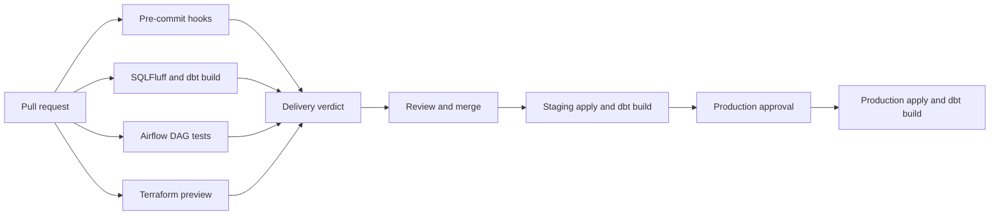

# CI/CD for retail data pipelines

A pull request changes a small retail revenue pipeline. Before merge, GitHub checks formatting, builds the warehouse from CSV, runs the Airflow DAG end to end, and previews infrastructure for three environments. The same commit can then deploy through staging and an approved production release.

The synthetic fixture contains five orders from three customers. Revenue is the sum of paid order amounts, measured in integer cents. Cancelled orders count toward volume and contribute zero revenue. The expected result is **5 orders and $70.00 revenue**. The mart grain is order date and customer segment.

## What runs where



| Gate | Evidence |
| --- | --- |
| Repository hooks | Whitespace, final newline, file size, YAML syntax, yamllint, Black and SQLFluff. A manual SQLFluff fix hook is available. |
| SQL and data tests | Full dbt build on an ephemeral DuckDB file and run-specific schema. Checks keys, relationships, statuses, amounts and raw-to-mart reconciliation. A negative control injects one invalid order into a copy and requires the specific amount test to fail. |
| DAG integration | Airflow DagBag import and dependency checks, callable failure tests, and an actual `dag.test()` execution that runs dbt and queries the published warehouse. JUnit XML is retained. |
| Terraform preview | Format and schema validation plus three real plans against empty, local state. PRs need no cloud identity. Each plan describes a regional dataset and a private landing bucket. |
| Delivery verdict | Combines all four outcomes, writes a job summary and comments on same-repository PRs with test counts and plan results. Forks use the Actions summary. |

Required checks run for every PR to main, including documentation changes, so a path filter cannot leave a required check pending. Full builds are inexpensive for this dataset and catch seed and dependency changes without a production manifest. CI files and schemas disappear with the runner. dbt artifacts, plan text, and JUnit results are retained for 14 days.

## Onboard a contributor

Use Git and Python 3.11. Run from the repository root in an activated virtual environment:

```sh
python -m venv .venv
# Activate: source .venv/bin/activate, or .\.venv\Scripts\Activate.ps1
python -m pip install -r requirements.txt
pre-commit install
pre-commit run --all-files
dbt build --project-dir dbt_project --profiles-dir dbt_project
```

To apply SQL formatting, run `pre-commit run sqlfluff-fix --hook-stage manual --all-files` and review the diff. SQLFluff renders the project's simple `ref()` calls using its Jinja dbt builtins. dbt then performs the adapter-specific compilation and executes every model. Set `WAREHOUSE_PATH` to choose the DuckDB file and `DBT_SCHEMA` to isolate a schema.

Create a feature branch, push it and open a PR against main. Inspect **Delivery verdict**, open any failed job, fix the issue and push to the same branch. An independent reviewer must approve before merge. Main requires up-to-date checks, dismisses stale reviews, and blocks force pushes and branch deletion. The repository owner can manage reviewer assignments in Settings.

### Run the Airflow checks locally

Use Linux or WSL with Python 3.11. Keep the dbt environment above and create a separate environment for Airflow to avoid conflicting dependencies:

```bash
export DBT_BIN="$(command -v dbt)"
python -m venv .venv-airflow
source .venv-airflow/bin/activate
pip install apache-airflow==2.11.0 --constraint https://raw.githubusercontent.com/apache/airflow/constraints-2.11.0/constraints-3.11.txt
pip install duckdb==1.3.2 pytest==8.4.2
export AIRFLOW_HOME="$(mktemp -d)"
export AIRFLOW__CORE__LOAD_EXAMPLES=false
export AIRFLOW__CORE__DAGS_FOLDER="$PWD/airflow/dags"
airflow db migrate
pytest airflow/tests -v
```

The daily DAG prepares a run-specific file, executes `dbt build`, then publishes through an atomic rename on the same filesystem. A failed build preserves the previously published database. Two retries are allowed, and a single active run serializes writes. For a running local scheduler, set `RETAIL_DATA_DIR` on shared storage, retain successful candidate files for recovery, and prune old candidates under your retention policy. This release workflow tests the DAG; installing DAG code into a long-lived Airflow cluster is a separate operational step.

## Enable cloud delivery

The PR preview has no access to deployed state. On an enabled release the workflow creates a fresh plan against the actual GCS backend, locks state, applies that exact saved plan in the same job, and then executes dbt against BigQuery. Terraform provisions the storage and datasets; the reference dbt release loads the versioned fixtures. Use dedicated sandbox projects/datasets for this example.

1. Bootstrap a restricted, versioned GCS state bucket outside this stack. Enable the BigQuery, Storage and IAM Credentials APIs and configure Google Workload Identity Federation for GitHub Actions. Restrict trust to this repository's immutable identity and the corresponding environment/ref. Authorize only the environment service account to impersonate its deployment identity.
2. Configure each GitHub Environment with the variables below. Grant its identity access to its state prefix and the permissions to manage its dataset and bucket, create query jobs, and write the dbt models. Separate GCP projects and identities are recommended for production isolation. The built-in GitHub token posts PR summaries; the Google auth action exchanges OIDC for short-lived credentials.
3. In repository **Settings → Environments**, verify the branch and reviewer restrictions shown below. Set the repository Actions variable `CLOUD_DEPLOY_ENABLED=true` only after the identities and backend are ready.

| Environment | Trigger and gate | Terraform state prefix |
| --- | --- | --- |
| dev | Successful push to develop or dispatch on develop | `retail/dev` |
| staging | Successful checks on main | `retail/staging` |
| prod | Same main commit after successful staging and approval by the configured production reviewer | `retail/prod` |

Required **environment variables** are `GCP_PROJECT`, `TF_STATE_BUCKET`, `WIF_PROVIDER` (full workload identity provider resource name), and `DEPLOY_SERVICE_ACCOUNT` (email). No Google private key is needed. Store future secret values in GitHub Environment Secrets and limit each job's permissions. Terraform 1.12.2 and the Google provider lock file pin the deployment toolchain. Production enables bucket versioning. Only the `transient/` prefix has automated object expiration. Buckets refuse forced destruction and datasets preserve untracked tables.

## Recovery and audit

Open the workflow run linked in the PR for failed-step logs, plan previews, dbt results and JUnit output. Enable GitHub Actions failure notifications in personal notification settings. The Environments deployment history records the revision, approval and job result.

If staging fails, production stays blocked. If apply partially succeeds, inspect the backend state and provider resources, correct the cause, then generate a fresh plan against the same environment. For a regression, pause the Airflow DAG, open a reviewed revert PR, and promote the tested revision through the same gates. A code revert cannot restore data removed by a migration; recover it from a verified backup first. Restore prior state generations only to repair state loss or corruption after reconciling real resources. Avoid overlapping manual changes with an active deployment.

Cloud apply and live BigQuery execution require a configured GCP project. The credential-free CI verifies the local data path, scheduler logic, and proposed infrastructure independently.
